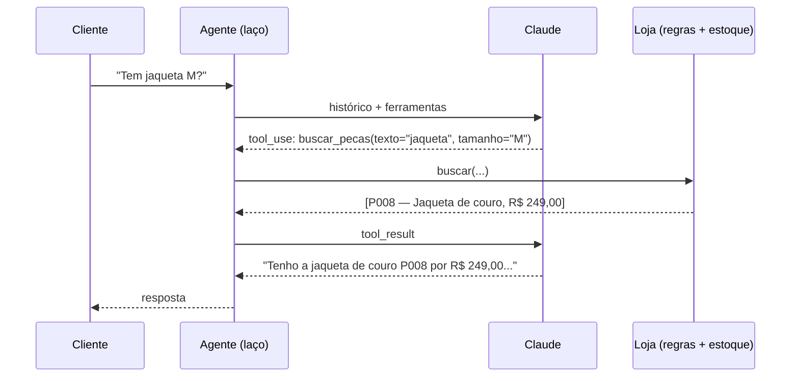

# agente-atendimento-brecho

Atendente virtual para **brechós e pequenas lojas de roupa**. O cliente escreve como escreveria no WhatsApp ("tem jaqueta M até 150 reais?"), e o agente procura no estoque, tira dúvidas sobre trocas e frete, reserva peças e fecha pedidos. Quando o assunto foge do que ele pode resolver, passa a conversa para uma pessoa.

O projeto nasceu de um produto que estou montando para vender a lojas: uma vitrine on-line para brechós. Este repositório é a parte de atendimento.

## O problema que ele resolve

Num brechó cada peça é única. Um atendente automático que "inventa" um preço, ou promete uma peça que já foi vendida, causa prejuízo e cliente irritado. Por isso a regra central do projeto é:

> **O modelo decide o que fazer. Os fatos (preço, estoque, regras) vêm sempre do código da loja.**

O Claude não tem acesso direto aos dados. Ele só enxerga a loja pelas **ferramentas**, e cada ferramenta aplica as regras de negócio antes de responder.



## Ferramentas

| Ferramenta | O que faz | Regras aplicadas pelo código |
|---|---|---|
| `buscar_pecas` | Procura por palavra, categoria, tamanho e preço máximo | Só mostra peças livres (nem vendidas nem reservadas); ignora acento e plural |
| `ver_peca` | Mostra todos os detalhes de uma peça, inclusive defeitos | Código inexistente vira erro explicado |
| `consultar_politica` | Trocas, frete, pagamento, reserva, estado das peças, retirada | Tema fora da lista é recusado pelo esquema (`enum`) |
| `reservar_peca` | Reserva por 24 horas | Não reserva peça vendida nem já reservada para outra pessoa; a reserva vence sozinha |
| `registrar_pedido` | Fecha o pedido e baixa o estoque | Confere disponibilidade e reserva de cada item; calcula o total no código |
| `chamar_atendente` | Passa para um humano | Registra o motivo para o dono da loja ver |

## Detalhes de engenharia

- **Laço do agente escrito à mão (`agente.py`)**, para controlar cada passo: limite de passos por mensagem (evita laço infinito e gasto sem controle; no limite, chama um atendente), tratamento de todos os `stop_reason` (`tool_use`, `end_turn`, `pause_turn`, `max_tokens`, `refusal`) e várias ferramentas pedidas de uma vez, devolvidas numa única mensagem.
- **Esquemas estritos (`strict: true`)**: a API garante que os argumentos seguem o esquema. Mesmo assim o executor valida de novo e transforma qualquer erro em `tool_result` com `is_error: true`, para o modelo explicar o problema ao cliente em vez de quebrar.
- **Auditoria**: toda chamada de ferramenta fica registrada (entrada, saída e erro).
- **Cache de prompt**: as instruções fixas vão com `cache_control`, então nas mensagens seguintes essa parte sai mais barata e mais rápida. O uso de tokens, inclusive o lido do cache, é somado por mensagem.
- **Proteção contra "jailbreak" simples**: o modelo é instruído a ignorar pedidos para mudar as regras. E, mesmo que obedeça, não tem ferramenta para dar desconto nem mudar preço. A segurança está no código, não só no prompt.
- **Fallback automático**: se o filtro de segurança recusar uma mensagem por engano, a API tenta de novo em outro modelo.
- **Relógio injetável**: os testes avançam o tempo para conferir que a reserva vence em 24 horas.

## Como rodar

```bash
pip install -e ".[dev]"
export ANTHROPIC_API_KEY=...        # sua chave da API da Anthropic
agente-brecho --mostrar-ferramentas
```

Exemplo de conversa:

```text
Cliente: oi, tem alguma jaqueta tamanho M?
  [ferramentas: buscar_pecas]
Loja: Oi! Tenho a Jaqueta de couro motociclista (P008), tamanho M, preta, por R$ 249,00.
      É couro legítimo, com algumas marcas de uso. Quer mais detalhes ou que eu reserve?
```

Para usar com outra loja, troque `dados/loja.json` (estoque, regras e contato) e rode com `--loja arquivo.json`.

## Testes

```bash
pytest
```

São 17 testes, sem gastar API: as regras da loja (busca, reserva, vencimento da reserva, pedido), as ferramentas (esquemas estritos, erros) e o laço do agente, com um "modelo roteirizado" que devolve respostas prontas. Os testes conferem, por exemplo, que o resultado da ferramenta volta com o `tool_use_id` certo, que várias ferramentas voltam numa mensagem só e que o limite de passos aciona um atendente.

## Próximos passos

- Integração com a API do WhatsApp Business.
- Painel para o dono da loja ver pedidos e conversas passadas para atendente.
- Medir a qualidade das respostas com o [avaliador-llm](https://github.com/Borniotti/avaliador-llm).

---

Desenvolvido por Matheus Borniotti com a ajuda de IA (Claude) como par de programação.
